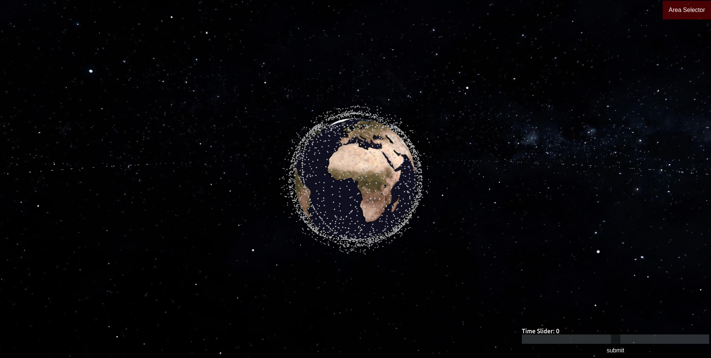
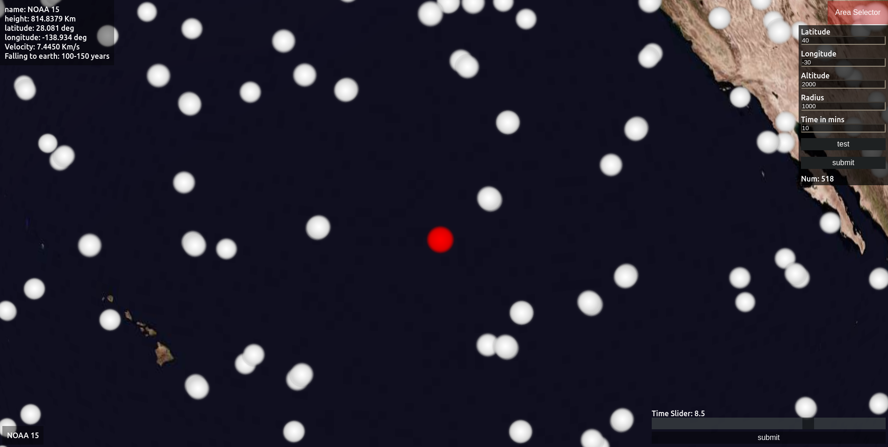
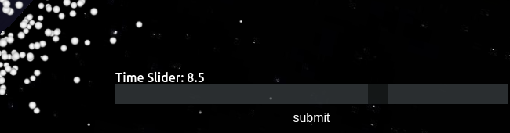
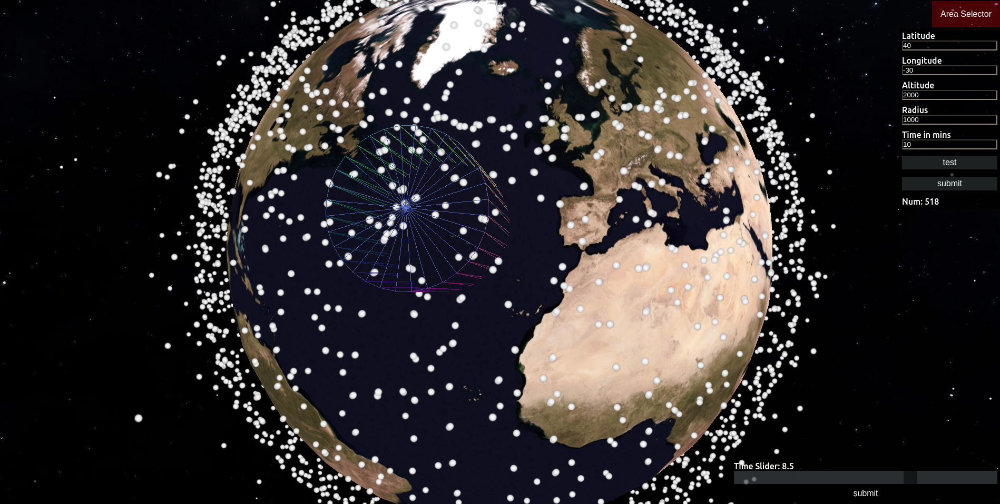

# Space Debris Prediction

An interactive 3D visualization of catalogued space objects using their bundled
Two-Line Element (TLE) sets.

## Setup
Download [Node.js](https://nodejs.org/en/download/).
Run this followed commands:

``` bash
# Install dependencies (only the first time)
npm install

# Run the local server at localhost:8080
npm run dev

# Build for production in the dist/ directory
npm run build
```

## Images of the program running
### The start screen


### Selecting certain object


### Selecting Time


### Selecting Certain volume/area and see how many debris pass in a selected time period


## Current prediction features

- Select a debris object to inspect its current propagated position and velocity.
- Request a 24-hour orbit projection calculated from a recent TLE with SGP4.
- Screen for the closest sampled approach to another catalogued object during
  that forecast. The result is a coarse screening aid, not a collision
  probability or maneuver recommendation.
- Adjust the displayed simulation time with the time slider.
- Play or pause the simulation and choose real-time or accelerated playback.
- Refresh debris TLEs from Space-Track, with CelesTrak as a fallback source.
- Automatically request a selected object's latest TLE from Space-Track when
  selected, with a direct CelesTrak object lookup fallback. Scenarios refresh
  the object again before running and refuse to use a latest available element
  older than 30 days. Catalog refresh preserves the selected object by NORAD ID.
- Run a close-approach screen, natural re-entry estimate, or hypothetical
  immediate de-orbit ground-track scenario for a selected object.
- Run a manually triggered, hypothetical satellite breakup scenario that
  displays deterministic fragment trajectory spreads over the next 24 hours.
  Any simplified Earth intersections are clearly distinguished from real
  collision detection or impact forecasts; fragment properties and collision
  physics are not inferred.
- Run an experimental 24-hour trajectory forecast using a linear Kalman
  measurement update (a Gaussian Bayesian estimate) over distinct TLE
  snapshots saved for the selected object in browser storage.
- Automatically import up to 100 historical TLE snapshots for a selected
  object from Space-Track, train a small browser-side LSTM in a separate Web
  Worker, and validate it chronologically against a persistence baseline
  before allowing it to contribute to the Bayesian de-orbit state estimate.
  The LSTM learns residual corrections to the latest propagated-TLE baseline;
  legacy absolute-state models are retrained before they can be used.
- Look up a selected object's published mass by name in Wikidata and resolve
  the modeled impact coordinates through OpenStreetMap, with optional Google
  Maps Geocoding fallback. Missing mass or population facts remain unknown;
  the LSTM does not infer those values.
- Request a server-side Gemini summary of retrieved object/map evidence and
  the modeled scenario. This retrieval-grounded explanation is not an impact,
  damage, casualty, or probability predictor.
- Show selected-object identifiers and CelesTrak SATCAT launch/orbit metadata,
  retrieved public program context, citations, and its propagated coordinates
  in an optional embedded satellite map. The configured shared Google Earth
  project can be opened separately, as can the selected object's Earth
  coordinates.
- Use Google Photorealistic 3D Tiles as the primary Earth view when a restricted
  `GOOGLE_MAPS_TILES_KEY` is configured. The TLE-propagated catalog, picking,
  selected-object coordinate labels, mapped impact/site markers, trajectories,
  de-orbit marker, and scenario footprint are drawn over the map. Globe layer
  toggles control satellites, object/place labels, and scenario overlays.
- Click a location on the Cesium globe to reverse-geocode its latitude and
  longitude to a place name when the public map service has a matching feature.
  Ocean, remote, and unmapped coordinates remain labeled by coordinates only;
  showing every place name at once is not practical at globe scale.
  Without a key or if tiles fail to load, the built-in globe remains available.

To enable Google Photorealistic 3D Tiles, enable the Google Maps Platform Map
Tiles API and set `GOOGLE_MAPS_TILES_KEY` in the server environment. The key is
necessarily visible to browsers making tile requests; restrict it by HTTP
referrer to the deployed app's host and by API to Map Tiles API. Google Maps
Platform billing and regional 3D coverage apply. The 3D tiles are not live
satellite video and do not provide spacecraft mass or telemetry.

The app starts with bundled TLE files. Live refresh first requests the complete
available debris TLE catalog from Space-Track through a small server-side proxy,
then falls back
to CelesTrak. When an object is selected, its current TLE is fetched separately
so it is refreshed even if it is outside the newest debris batch. All unique
bundled and fetched catalog objects are retained. The globe renders the object
positions as a single point cloud rather than creating one 3D draw object per
satellite. Orbit positions are initialized in short batches, and the display
refreshes them every five seconds while the simulation clock remains current;
hover picking is limited to one check per animation frame.

If a selected object's TLE is stale, the close-approach scenario can still show
an illustrative extrapolated orbit, but it does not report a collision screen.
Use a recent TLE for close-approach results; use the de-orbit option for the
hypothetical descent animation.

Running a scenario temporarily hides the full catalog so the selected object's
trajectory is easy to see. The de-orbit scenario animates the selected object
along a simplified path to the spherical-Earth surface; **Close simulation and
restore catalog** brings all catalog objects back. This visualization can run
from an old TLE, but its displayed impact location is illustrative only and is
not a reliable prediction. Close-approach screening still requires a recent TLE.
Space-Track requires an account. Keep its credentials on the server; never put
them in browser code or commit them. For reusable local configuration, copy
`.env.example` to `.env.local` and put your Space-Track credentials in that
file:

```powershell
Copy-Item .env.example .env.local
# Edit .env.local; add API keys only if enabling those optional services
npm run dev
```

`.env.local` is excluded from Git. The server reads it automatically when it
starts; process environment variables take precedence. Set `GEMINI_API_KEY`
to enable the optional AI summary. Set `GOOGLE_MAPS_API_KEY` to enable Google
Maps Geocoding as a region-name fallback; OSM remains available without it.
To show the on-page Google Maps satellite view, also set
`GOOGLE_MAPS_EMBED_KEY`. This key is necessarily visible to the browser: use a
separate key restricted by HTTP referrer to your local/deployed site and to
the Maps Embed API. Enable the required APIs and billing in Google Cloud.
Rotate any password previously shared in chat before saving the replacement
locally.

If credentials are not configured, or Space-Track is unavailable, the app
reports that error and tries CelesTrak. CelesTrak limits downloads to once
every two hours per group; successful responses are cached in the browser.
For local development, `npm run dev` provides both same-origin API routes. For
production, the included `npm start` server serves the built `dist/` site and
provides `/api/spacetrack/*` and `/api/impact/*`; it listens on Render's
`PORT` and `0.0.0.0`. Selecting an object automatically starts the background
history import and LSTM training workflow for that NORAD ID. It requests up to
100 GP history records and displays progress and errors in the estimator status;
the background engine checks for updated history every two hours while the app
is open and the object remains selected, and retrains when distinct snapshots
arrive. It does not continuously consume CPU training on unchanged data; the
LSTM is trained from TLE observations, not by an external AI service. Running
the de-orbit scenario does not
wait for history import or background training: it uses an already available
LSTM only when it passes the chronological persistence-baseline test, otherwise
it runs with the Kalman/Bayesian estimate and reports the LSTM status. Run it
again after training completes to try the updated model. The trained model is
stored in browser IndexedDB for that object; its validation metadata is stored
locally. Live refresh and history import require an internet connection.
TensorFlow.js is loaded only when training or running an available LSTM model,
so it does not add its large runtime to the initial page load.
The project does not include a pre-trained machine-learning model or operational
collision-avoidance system. Close-approach and natural re-entry scenarios
require a TLE no more than 30 days old. The Bayesian/Kalman scenario remains
available for older TLEs, but its result is illustrative and its assumed
uncertainty is not calibrated. Natural re-entry lifetime is a coarse
altitude-based estimate; the immediate de-orbit scenario uses the limited
upper-atmosphere drag model described below and does not model heating,
fragmentation, lower-atmosphere behavior, or object survival.

The experimental Kalman/Bayesian forecast is separate from the SGP4
close-approach screen. The immediate de-orbit scenario initializes its
idealized descent from that estimated mean state and uses a simplified
exponential-density drag model only if Wikidata provides a matching mass.
Because object shape/area is not generally available, the area is derived from
that mass as an equivalent sphere at an assumed 2700 kg/m³ bulk density. The
model also varies density by 0.5–1.5× and eastward wind by ±50 m/s. These are
explicit sensitivity assumptions, not measured object shape or live weather.
It treats the published catalog mass as one intact object and does not model
mass loss, ablation, or fragmentation.
The model applies only between 70 and 130 km altitude and does not simulate
lower-atmosphere deceleration, heating, fragmentation, or survival. If mass is
unknown, drag is omitted. The displayed footprint is the 90th-percentile
distance among deterministic one-axis ±1σ state and atmosphere scenarios; it
is not a confidence region, a probability of impact, or a physical damage
radius.

The app searches Wikidata by the selected object's name and only accepts a
clearly matching spacecraft/satellite item with a mass stated in kilograms or
grams. The source link and matched name are shown. Debris/fragment names are
not matched to a parent spacecraft's mass. No matching record means mass is
unknown and drag is omitted. This is a catalog property, not verified surviving
mass after re-entry.

Impact coordinates are reverse-geocoded through OpenStreetMap Nominatim to
show an approximate region/country. If the returned map feature has a
population tag, its source and total population are shown. That feature total
is not a count of people inside the footprint; local exposed population remains
unknown without a suitable gridded population dataset. A ring on the globe
marks the scenario envelope.

Actual damage, exposed population within the footprint, and casualties are
reported as **unknown** unless appropriate verified data and validated
fragmentation/impact models are available. The outline is a trajectory
sensitivity envelope, not a damage estimate. The LSTM is trained only on
historical TLE-derived state patterns; it does not search the web to train
itself, nor does it estimate mass, weather, population, or casualty outcomes.

The estimator propagates each available TLE to the
selected time, then combines the resulting states using an identity-observation
linear Kalman update. Because TLEs do not supply calibrated covariance, its
position and velocity error assumptions are explicit approximations; the displayed 1σ
values are not validated accuracy bounds. The implementation assumes a
position standard deviation of `2 km + 0.05 km × TLE age in days` and a
velocity standard deviation of `0.002 km/s + 0.00005 km/s × TLE age in days`,
with independent state components; correlated TLE errors are not modeled.
The forecast path uses two-body gravity and omits drag, Earth oblateness, and other perturbations. Only
distinct TLE line pairs received for the currently selected object are
archived in browser storage (maximum 100); repeated refreshes of unchanged
TLEs do not count as new history. LSTM training uses chronological next-TLE
state residuals built by comparing each historical TLE with the preceding
TLE propagated to the next element set's epoch. The model must beat the
zero-residual (persistence) baseline on later held-out samples before its
output is blended into the Kalman/Bayesian state. This is
an experimental model of TLE-derived states, not an independent measurement
or a validated impact predictor. If history is insufficient or validation
does not beat baseline, the app uses the Kalman/Bayesian state without LSTM.

## Deploy to Render

1. Push this project to a GitHub repository and create a Render **Blueprint**
   from that repository. `render.yaml` configures the Node web service, build,
   start command, and health check.
2. In Render's service environment settings, add the Space-Track credentials
   and `GEMINI_API_KEY`. Add `GOOGLE_MAPS_API_KEY` only if you want the optional
   Google Geocoding fallback. The Blueprint marks these values as secret
   inputs; do not commit real keys to GitHub or put them in browser code.
3. Use `npm run build` and `npm start` locally to check the production server.
   `GET /healthz` should return `ok`.

The Gemini endpoint retrieves an exact-name Wikidata object record and map
evidence from OpenStreetMap/optional Google Geocoding, then asks Gemini to
summarize only those facts. The model response is accompanied by retrieved
source links. This is a lightweight retrieval-grounded generation flow, not
a trained impact model or a vector database. A mapped feature's population
tag is not a count within the footprint. Damage and casualties remain unknown
without verified fragment survival, local weather/population data, and
validated impact-effects models; the AI is instructed not to estimate them.
For object identity, catalog names, NORAD IDs, and international designators
come from the selected TLE. If an exact match is unavailable, the page labels
Wikipedia/Wikidata results as family-level context rather than asserting they
describe that individual object. The LSTM predicts orbital state only; it is
not used to retrieve or invent factual information and remains excluded when
it does not beat its persistence baseline. Google Maps satellite imagery and
Google Earth views are not live satellite video; the app's globe animates the
TLE-propagated position.
